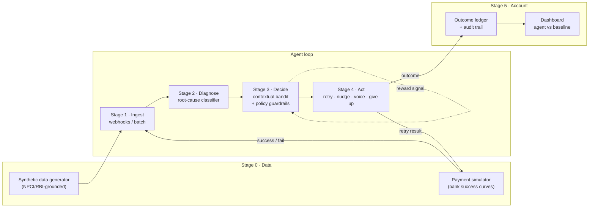

# RecoverIQ — Product Requirements Document

**An autonomous revenue-recovery agent that finds failed payments, learns the smartest moment to retry them, and wins the money back — with a full audit trail.**

| | |
|---|---|
| **Track** | 03 — AI Revenue Recovery (Razorpay AI Buildathon) |
| **Deadline** | Applications close **September 5, 2026** (~16 days from Aug 20) |
| **Submission** | Public GitHub repo · 5-minute pitch video · architecture walkthrough |
| **Judging bar (from Razorpay's page)** | "Show **measured money recovered across a batch**, with **compliant escalation**, **stopping rules**, and an **audit trail**." |

---

## 1. Problem

Indian merchants running subscriptions and recurring payments lose revenue silently and continuously:

- **UPI Autopay / e-mandate debits bounce** for reasons that are often *temporary* — insufficient balance right before salary day, bank server downtime, NPCI congestion, per-transaction limits.
- Merchants retry these failures on **dumb cron schedules** (e.g., "retry every 24h, 3 times") that ignore *why* the payment failed and *when* it's most likely to succeed.
- Retries are a **scarce, regulated resource**: RBI/NPCI rules cap how a failed mandate can be re-presented, so a wasted retry is recovery permanently lost.
- Checkout failures and overdue payment links suffer the same fate: a generic reminder at a generic time, then silence.

The result: recoverable money is written off, not because recovery is hard, but because nobody is making *per-failure, per-timing* decisions at scale.

## 2. The product

RecoverIQ is a pipeline of five stages. A failed payment enters at one end; recovered rupees, or an honest, logged "gave up — here's why," exits at the other.

**The core differentiator:** the retry-timing brain is a **contextual bandit** (a learning decision engine), not an LLM prompt. The LLM (Claude) is used only where language is the job — explaining decisions in plain English and drafting customer nudges. This makes the system fast, cheap, deterministic to replay, and defensible in a panel interview.

### What "winning" looks like in the demo

A dashboard where the agent's **₹ recovered** curve visibly beats a naive-cron baseline across a 1,000-payment simulated batch — e.g., *+20–25% more recovered with ~40% fewer retry attempts* — next to a per-case audit trail and one case where the agent correctly stopped trying.

## 3. Goals & success metrics

| Goal | Metric | Target |
|---|---|---|
| Recover more money than the baseline | ₹ recovered vs. naive-cron retry policy on the same batch | ≥ +15% relative |
| Spend retries efficiently | Retry attempts used per ₹ recovered | ≤ 60% of baseline |
| Diagnose failures correctly | Root-cause classification accuracy on labeled synthetic set | ≥ 90% |
| Stay compliant | Zero retries beyond RBI/NPCI caps; zero contact after opt-out | 0 violations (hard gate) |
| Be auditable | Every action reconstructable from the audit log | 100% of cases |
| Be honest | Published exception list: cases the agent could not recover, with reasons | Required in README |

## 4. Non-goals

- **No real customer data, no live money.** Everything runs on synthetic data + Razorpay **test-mode** APIs.
- **No fraud/risk scoring** (that's Track 2; keep scope clean).
- **No production-grade telephony.** Voice escalation is demonstrated with generated Hinglish audio, not a live PSTN call.
- **Not a general dunning SaaS.** One loop, done deeply: failed recurring payment → recovered or closed.

## 5. Pipeline



### Stage 0 — Synthetic data & simulator *(the moat)*

- **Generator** produces 1,000+ failed-payment records: subscription debits, checkout drops, overdue payment links. Each has a merchant, amount, bank, failure code, timestamp, and customer profile.
- Failure distributions are **grounded in public sources, cited in the repo**: NPCI monthly UPI stats and bank-wise downtime/decline patterns, RBI circulars on e-mandate re-presentation, published UPI failure-code documentation.
- **Simulator** answers one question: *if you retry payment X at time T, does it succeed?* Success probability varies by bank, failure code, day-of-month (salary-day spike on the 1st–3rd), and hour-of-day. Hidden from the agent; the agent must *learn* it.
- Seeded RNG → every experiment is reproducible.

**Output:** `data/failed_payments.jsonl`, `data/generator_config.yaml`, `simulator/`.

### Stage 1 — Ingestion

- Two entry paths: **batch** (load the JSONL) and **live** (Razorpay test-mode webhooks — `payment.failed`, `payment_link.expired` — via a FastAPI endpoint) to prove real platform integration.
- Normalizes every event into a single `RecoveryCase` record with state `NEW`.

### Stage 2 — Diagnosis

- A deterministic **failure-code classifier** maps each case to a root cause: `INSUFFICIENT_FUNDS`, `BANK_DOWNTIME`, `LIMIT_EXCEEDED`, `MANDATE_PAUSED`, `USER_DROPPED`, `TECHNICAL_DECLINE`, `HARD_DECLINE` (card blocked / mandate revoked → unrecoverable).
- Claude is used **only** for ambiguous/long-tail codes and to write the one-line human explanation stored on the case ("Debit bounced at 6 AM on the 29th — balance likely low before salary credit").
- Hard declines skip straight to `CLOSED_UNRECOVERABLE` — the agent knowing when *not* to try is part of the pitch.

### Stage 3 — Decision engine *(the brain)*

- A **contextual bandit** (LinUCB or Thompson sampling; ~200 lines of NumPy, no framework) chooses an action for each open case:
  - **Context:** root cause, bank, amount bucket, days-to-salary-day, hour, attempts used, customer responsiveness so far.
  - **Arms:** retry-now · retry at one of several scheduled slots (salary-day morning, evening, next NPCI-quiet window) · send payment-link nudge · escalate to voice · give up.
  - **Reward:** ₹ recovered minus per-action cost (each retry, message, and call has a cost, so the policy learns *efficiency*, not just recovery).
- **Policy guardrails wrap the bandit — the bandit proposes, the guardrails dispose:**
  - Max re-presentations per mandate per RBI/NPCI caps (hard limit, configurable in `policy.yaml`).
  - Contact windows only 8 AM–9 PM; max N nudges per case; instant halt on opt-out.
  - Amount ceiling above which any action requires a human-approval flag (bounded autonomy).
- Every decision logs: context vector, arm chosen, expected value, guardrail checks passed, and Claude's plain-English rationale.

### Stage 4 — Intervention executor

- **Smart retry:** re-attempt via simulator (batch mode) or Razorpay test-mode order/payment APIs (live mode).
- **Nudge:** creates a real Razorpay test-mode **Payment Link**; drafts a short Hinglish message with Claude (template-constrained — no free generation into customer channels).
- **Voice escalation (the wow moment):** for high-value cases, generates a Hinglish voice script with Claude and renders it to audio via TTS; the demo plays the actual call audio. Records a **promise-to-pay** date when the simulated customer commits, and follows up on that date.
- **Give up:** closes the case with a reason code — visible proof of stopping rules.

### Stage 5 — Outcome ledger & dashboard

- Append-only **audit trail** (SQLite table): every state transition, actor (`agent`/`guardrail`/`human`), timestamp, rationale. Any case's full history is one query.
- **Dashboard** (Next.js): headline tiles (₹ at risk → ₹ recovered → recovery rate), the agent-vs-baseline recovery curve, the bandit's learning curve, a case explorer with per-case timelines, and the exception list.

## 6. Evaluation plan (this is a section judges rarely see — make it loud)

1. Freeze one synthetic batch of 1,000 failed payments (published in the repo).
2. Run **Baseline A**: naive cron (retry every 24h × 3). Run **Baseline B**: retry-all-immediately.
3. Run **RecoverIQ** on the identical batch with the same simulator seed.
4. Report: ₹ recovered, recovery rate, attempts used, cost per recovered ₹, guardrail violations (must be 0), and the unresolved-exception list.
5. Publish a `make evaluate` command so a judge can reproduce every number.

## 7. Tech stack

| Layer | Choice | Why |
|---|---|---|
| Agent core, simulator, bandit | **Python** (FastAPI, NumPy, Pydantic) | Fast to build; bandit stays transparent, no ML framework magic |
| LLM | **Claude API** (claude-sonnet-5) | Diagnosis long-tail, rationales, Hinglish comms drafting — small, replaceable role by design |
| Payments | **Razorpay test-mode APIs** (Payments, Payment Links, webhooks) | Real platform engagement — a stated judging signal |
| Store | **SQLite** | Zero-ops, ships in the repo, judges can open it |
| Dashboard | **Next.js + a lightweight chart lib** | Polished demo surface |
| Voice | Any Hinglish-capable TTS (e.g., Sarvam AI / ElevenLabs) | Pre-rendered clips are fine — it's a demo, not infra |

## 8. Data model (core tables)

- **`recovery_cases`** — id, source (mandate/checkout/link), merchant, customer, amount, bank, failure_code, root_cause, state (`NEW → DIAGNOSED → IN_RECOVERY → RECOVERED | CLOSED_UNRECOVERABLE | CLOSED_EXHAUSTED | CLOSED_OPTOUT`), attempts_used, recovered_amount.
- **`decisions`** — case_id, context_json, arm, expected_value, guardrails_passed, rationale, created_at.
- **`actions`** — case_id, decision_id, type (retry/nudge/voice/close), payload (e.g., payment_link_id), result, cost.
- **`audit_log`** — append-only: case_id, actor, event, detail, timestamp.
- **`policy`** — versioned YAML snapshot of caps/windows in force (so old decisions are judged by the rules active at the time).

## 9. Repo structure

```
recoveriq/
├── README.md              # product story, metrics table, demo GIF, "what didn't work"
├── ARCHITECTURE.md        # this pipeline + diagram, decision log
├── data/                  # generator + frozen evaluation batch + source citations
├── simulator/             # bank success-curve engine (seeded)
├── agent/
│   ├── ingest.py
│   ├── diagnose.py
│   ├── bandit.py          # LinUCB/Thompson — the brain, ~200 lines, heavily commented
│   ├── guardrails.py      # policy.yaml enforcement
│   └── act.py             # retry / nudge / voice / close
├── integrations/          # razorpay test-mode client, webhook receiver, claude client, tts
├── eval/                  # baselines, runner, metrics report (make evaluate)
├── dashboard/             # Next.js app
└── policy.yaml            # RBI caps, contact windows, amount ceilings, stopping rules
```

## 10. Build plan (Aug 20 → Sep 5)

| Days | Milestone | Definition of done |
|---|---|---|
| **1–2** | Skeleton + data | Repo scaffolded; generator emits 1,000 grounded records; simulator returns seeded success/fail |
| **3–4** | Core loop v0 | Ingest → diagnose → *random* policy → simulated retry → ledger. End-to-end on the batch |
| **5–7** | The brain | Bandit replaces random policy; guardrails enforced; learning curve visibly improves; baselines implemented |
| **8–9** | Razorpay integration | Test-mode webhook ingestion + real Payment Link creation working in live mode |
| **10–11** | Dashboard | Tiles, agent-vs-baseline chart, case explorer with audit timeline |
| **12** | Voice + nudges | Hinglish TTS clip for a high-value case; promise-to-pay follow-up flow |
| **13** | Evaluation freeze | `make evaluate` reproduces all README numbers; exception list written |
| **14** | Video + polish | 5-min pitch recorded; README complete incl. "What didn't work"; repo public |
| **15–16** | Buffer | Panel prep: rehearse defending every architecture decision |

## 11. Pitch video script (5:00)

1. **0:00–0:30 — The problem, in rupees.** A merchant's bounced-debit reality; ideally a 10-second clip or quote from one real merchant you spoke to.
2. **0:30–3:00 — Live demo.** Batch flows in → dashboard counter climbs → open one case: diagnosis, the bandit's choice and *why*, the retry succeeding on salary-day morning. Play the Hinglish voice clip. Then the honesty beat: a case the agent closed after hitting the RBI cap, and its audit trail.
3. **3:00–4:00 — Architecture.** The pipeline diagram; one line on why the brain is a bandit and Claude is deliberately kept small.
4. **4:00–5:00 — Measured results + what didn't work.** The agent-vs-baseline table, the exception list, one approach you abandoned and why.

## 12. Risks & mitigations

| Risk | Mitigation |
|---|---|
| Bandit doesn't beat baseline convincingly | Tune simulator so timing genuinely matters (it does in reality — salary-day effects are large); if margins stay thin, report honestly and show the efficiency win (fewer attempts) instead |
| Scope creep (voice, dashboard polish) eats core time | Core loop + evaluation are days 1–7 and non-negotiable; voice and polish are cut-first features |
| "This is just simulated" objection | Own it: publish the simulator's grounding sources and the live Razorpay test-mode path; the *decision architecture* is what's being judged |
| Same-idea collision with other students | The moat is Stage 0 (cited, grounded data) + Stage 3 (a learning policy, not a prompt) + honest evaluation — three things a wrapper build won't have |

## 13. Panel-prep questions to be able to answer cold

- Why a contextual bandit and not RL, a supervised model, or simple heuristics?
- How do you know your simulator isn't rigged in the agent's favor?
- What happens when RBI changes the retry cap? (Answer: `policy.yaml`, versioned, guardrails outside the learner.)
- Where exactly does Claude sit, what happens if it's down, and could you swap it out?
- How would this transition from simulator to real traffic? (Shadow mode → bounded live cohort → gradual arm unlock.)
