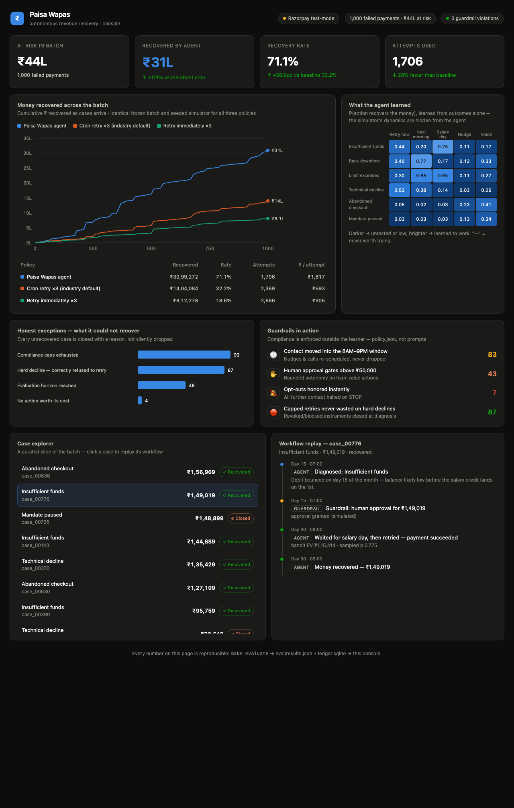
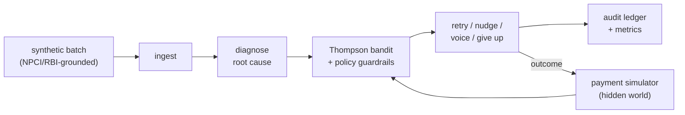

# RecoverIQ 💸

**An autonomous revenue-recovery agent for Indian recurring payments.** It
diagnoses *why* a payment failed, then a learning decision engine picks the
smartest intervention and moment — retry on salary-day morning, wait out a
bank outage, send a Hinglish nudge, escalate to a voice call, or honestly
give up — under hard RBI-style compliance guardrails, with every action on
an audit trail.

> Razorpay AI Buildathon · Track 03 — AI Revenue Recovery

## Measured results (reproduce with `make evaluate`)

Same frozen batch of **1,000 failed payments (₹43.6L at risk)**, same seeded
simulator, three policies:

| Policy | ₹ recovered | Recovery rate | Attempts used | ₹ recovered / attempt |
|---|---:|---:|---:|---:|
| Retry immediately ×3 | ₹6,06,823 | 13.9% | 2,738 | ₹222 |
| Cron retry every 24h ×3 (industry default) | ₹11,91,563 | 27.3% | 2,505 | ₹476 |
| **RecoverIQ agent** | **₹31,45,967** | **72.2%** | **1,624** | **₹1,937** |

**+164% more money recovered than the cron baseline, with 35% fewer
attempts** — and zero guardrail violations (contact windows, retry caps,
opt-outs are enforced structurally and asserted in the eval).

The agent also reports what it could **not** recover — 257 cases: 88 that hit
the evaluation horizon, 87 hard declines it correctly refused to spend retries
on, 79 where compliance caps ran out, 3 abandoned because no action was worth
its cost.

The batch's bank mix and decline split come from NPCI's published UPI
statistics (`make sources`); see [data/SOURCES.md](data/SOURCES.md).

### What the decision engine learned, on its own

The simulator's true dynamics are hidden from the agent. From outcomes
alone, its Thompson-sampling bandit learned (posterior means from
`eval/results.json`):

| Failure cause | Best learned action | Learned P(success) |
|---|---|---:|
| Insufficient funds | **Wait and retry on salary day** | 0.75 |
| Bank downtime | Retry next morning (outage passes) | 0.77 |
| Abandoned checkout | Voice call (retries ≈ useless: 0.05) | 0.42 |

No LLM makes money decisions. Claude is used only where language is the job
— long-tail failure-code classification, plain-English audit rationales, and
template-constrained Hinglish nudges (`integrations/claude_client.py`).

## The operator console — a working product, not a report

```bash
make app        # → http://localhost:8420
```

The same agent runs live, event-driven on a simulated clock (1h–24h per
second, operator-controlled). The bandit **warm-starts from the 1,000-case
training batch, then keeps learning from live outcomes**. From the console
an operator can:

- **Start/pause the agent** and watch every diagnosis, decision, guardrail
  intervention, and recovery stream into the live activity feed
- **Approve or deny high-value actions** from an inbox — anything above the
  autonomy ceiling waits for a human, with the agent's proposed action,
  expected value, and confidence attached. If approval arrives after the
  intended slot, the agent re-derives its smart timing rather than firing
  at bad odds
- **Inject a failed payment by hand** and watch it get diagnosed, scheduled,
  and recovered
- **Edit the compliance policy live** (caps, contact window, approval
  ceiling) — enforced from the very next decision, no retrain, because the
  guardrails live outside the learner

## The batch-results console



`make dashboard` opens a zero-dependency console showing the recovery race
against both baselines, the policy the bandit learned, the honest exception
list, every guardrail intervention, and a **workflow replay** — the full
audit timeline of any case (diagnose → guardrail gate → decision with its
expected value → outcome).

## Quickstart

```bash
pip install numpy        # the only dependency for the full evaluation
make data                # regenerate the synthetic batch (seeded)
make evaluate            # agent vs baselines → eval/results.json + ledger.sqlite
make dashboard           # open the recovery console (static, offline-safe)
make inspect             # audit trail of the largest recovered case
```

## How it works



1. **Diagnose** ([agent/diagnose.py](agent/diagnose.py)) — deterministic
   failure-code → root-cause mapping; hard declines are closed immediately
   instead of wasting capped re-presentations.
2. **Decide** ([agent/bandit.py](agent/bandit.py)) — per (cause, action)
   Beta posteriors; picks the action maximising `p̂ × amount − cost`. Giving
   up is always worth ₹0, so unprofitable chases stop themselves.
3. **Guard** ([agent/guardrails.py](agent/guardrails.py) +
   [policy.json](policy.json)) — RBI-style re-presentation caps, 8AM–9PM
   contact window, opt-out halt, human-approval gate above ₹50,000. Lives
   *outside* the learner: a regulation change is a config edit, not a
   retrain.
4. **Act & account** ([agent/runner.py](agent/runner.py)) — executes,
   observes, updates the bandit, and appends everything to an append-only
   audit log (`ledger.sqlite`).

Grounding for the synthetic world (salary-day bounce cycle, bank-wise
reliability, NPCI failure codes, re-presentation caps): [data/SOURCES.md](data/SOURCES.md).

## Honest limitations

- Recovery percentages are measured **inside a simulator we built**. The
  sources justify its structure, not its exact probabilities; the fair claim
  is the *relative* gap vs baselines within the same world, plus the shape
  of what the agent learned.
- Live path ([integrations/razorpay_client.py](integrations/razorpay_client.py))
  creates real test-mode Payment Links and normalises `payment.failed`
  webhooks, but the end-to-end live loop and dashboard are still in progress
  (see PRD build plan, days 8–12).

## What didn't work

*(kept honestly, per the project's own bar)*

- To be filled as the build progresses — first entry candidates: reward
  shaping experiments, LinUCB vs Thompson comparison.

## Repo map

See [PRD.md](PRD.md) for the full product spec, evaluation protocol, build
plan, and pitch-video script.
